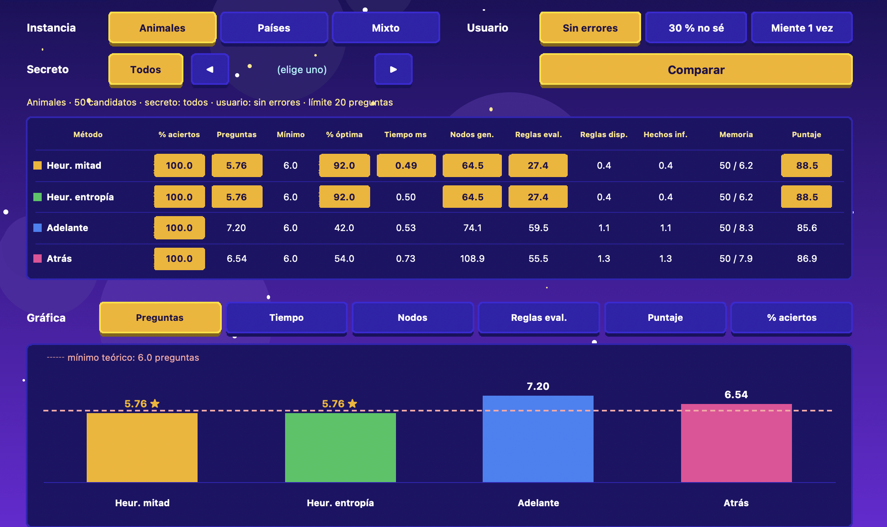

# Akinator: sistema experto que adivina animales y países

Proyecto final de **Representación y Solución Automática de Problemas** (Universidad del Rosario).

El usuario piensa en un animal o en un país y el sistema lo adivina con preguntas de **sí, no o no sé**. Usa una base de conocimiento con hechos y reglas, y tres formas de razonar: encadenamiento hacia adelante, encadenamiento hacia atrás y selección por heurística.


## Modos de juego

| Modo | Candidatos | Características |
|---|---|---|
| Animales | 50 | 19 (plumas, pelo, da leche, vive en el agua…) + 21 reglas |
| Países | 50 | 34 (continente, idioma, bandera, Mundial…) + 18 reglas |
| Mixto | 100 | Animales y países juntos |

## Algoritmos

- **Encadenamiento hacia adelante:** pregunta en el orden de los datos y, después de cada respuesta, dispara las reglas para deducir hechos nuevos.
- **Encadenamiento hacia atrás:** toma una hipótesis (el candidato más probable) y pregunta lo necesario para confirmarla, con búsqueda AND/OR.
- **Selección por heurística:** elige la pregunta que mejor divide a los candidatos. Tiene dos versiones: **mitad** (menor |sí − no|) y **entropía** (más información).

## Instalación

Solo se necesita **Python 3.10 o superior**. El juego usa únicamente la librería estándar, incluido `tkinter` para la interfaz.

```bash
git clone https://github.com/kilejo06/Proyecto-akinator.git
cd Proyecto-akinator/akinator
```

Para abrir el notebook, instala Jupyter:

```bash
pip install -r requirements.txt
```

## Ejecución

Todos los comandos se ejecutan desde la carpeta `akinator/`.

| Qué | Comando |
|---|---|
| Interfaz gráfica | `python gui.py` |
| Versión en consola | `python main.py` |
| Notebook de ejemplo | `jupyter notebook akinator.ipynb` |
| Validar los datos | `python pruebas/validar_datos.py` |
| Comparar los métodos | `python pruebas/simulacion.py` |

## Interfaz gráfica

### Jugar: "Yo pienso"
El usuario piensa en algo y responde las preguntas.


### Que juegue el agente
Se elige un secreto y el agente juega solo. La partida se reproduce paso a paso con los controles de iniciar, pausar, adelante, atrás y velocidad. En pantalla se ven los candidatos descartados, las reglas disparadas, los hechos nuevos y por qué se eligió cada pregunta.


<!-- Captura de la reproducción con el panel de razonamiento -->

### Comparar
Ejecuta los cuatro métodos sobre los mismos secretos y muestra una tabla y una gráfica de barras. Las métricas son: tiempo, nodos generados, memoria, preguntas, puntaje, partidas óptimas, reglas evaluadas y disparadas, y hechos inferidos.


<!-- Captura de la tabla y la gráfica de comparación -->

### Ajustes
Permite elegir el método, la heurística, el límite de preguntas (5 a 40), el fondo y si se muestra el razonamiento.


<!-- Captura de la pantalla de ajustes -->

## Resultados

Preguntas promedio jugando contra todos los candidatos, con un usuario que responde bien:

| Método | Animales | Países | Mixto |
|---|---|---|---|
| Heurística (mitad y entropía) | 5,76 | 5,72 | 6,74 |
| Encadenamiento adelante | 7,20 | 6,80 | 8,07 |
| Encadenamiento atrás | 6,54 | 7,90 | 10,19 |
| Mínimo teórico (⌈log₂ N⌉) | 6 | 6 | 7 |

## Estructura

```
akinator/
├── gui.py, gui_*.py        Interfaz gráfica
├── main.py                 Versión en consola
├── partida.py, agente.py   Estado, acciones y recompensas
├── motor_inferencia.py     Encadenamiento hacia adelante y hacia atrás
├── heuristica.py           Heurísticas mitad y entropía
├── base_conocimiento.py    Carga de hechos y reglas
├── comparacion.py          Comparación de métodos
├── akinator.ipynb          Notebook de ejemplo
├── datos/                  Animales, países, reglas y preguntas (JSON)
└── pruebas/                Validación de datos y simulación
```

## Autor

Kilian Alejandro Florez Peña
